# Azure DevOps Ops for Herdr

A Herdr desktop panel for pull requests, CI runs, assigned work items, and optional Advanced Security alerts.
It uses your Azure CLI authentication and confirms write actions before sending them.

## Screenshots

These use fictional mock data (org, people and runs).

<table>
  <tr>
    <td align="center" valign="top"><a href="docs/screenshots/01-prs.png">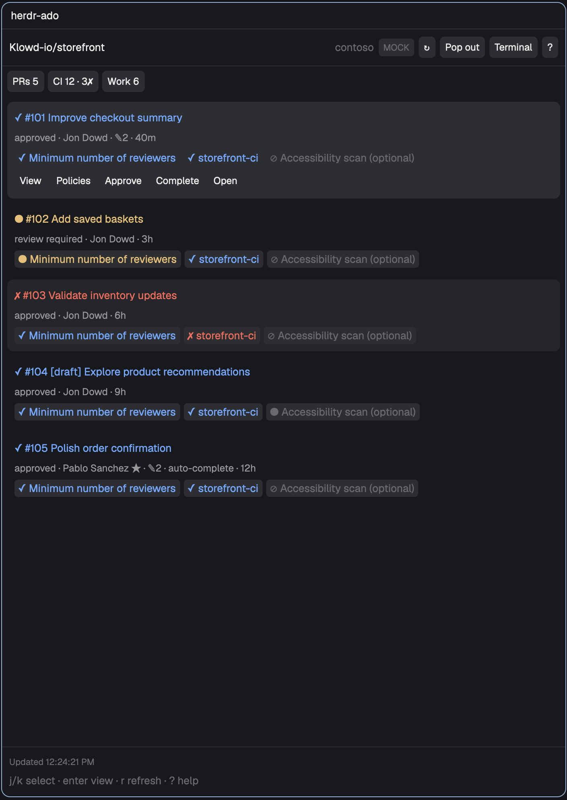</a><br>Pull requests</td>
    <td align="center" valign="top"><a href="docs/screenshots/02-pr-detail.png">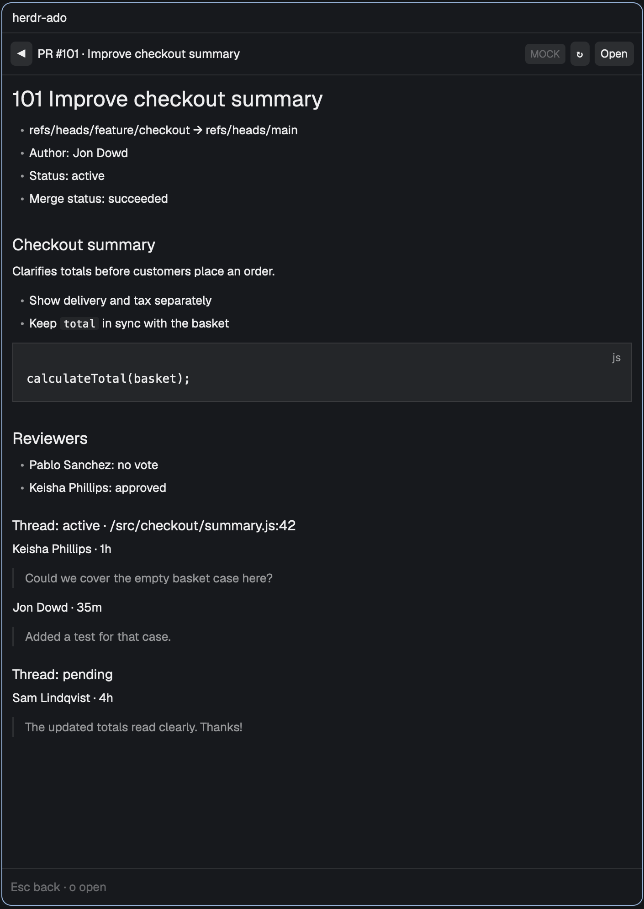</a><br>PR detail</td>
    <td align="center" valign="top"><a href="docs/screenshots/03-policies.png">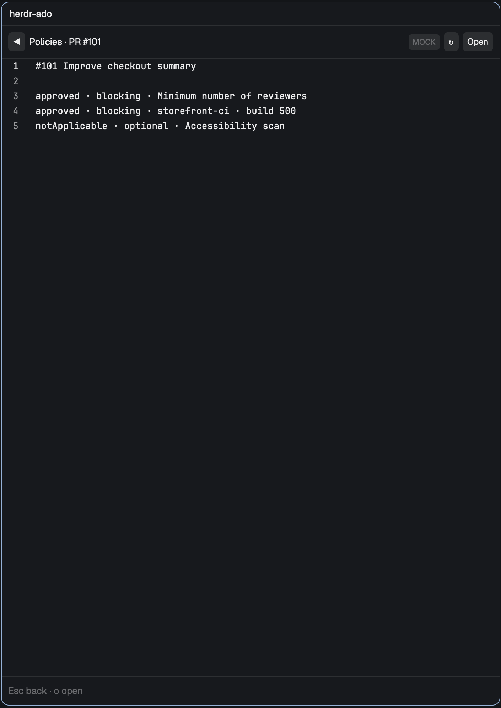</a><br>Policies</td>
  </tr>
  <tr>
    <td align="center" valign="top"><a href="docs/screenshots/04-approve-dialog.png">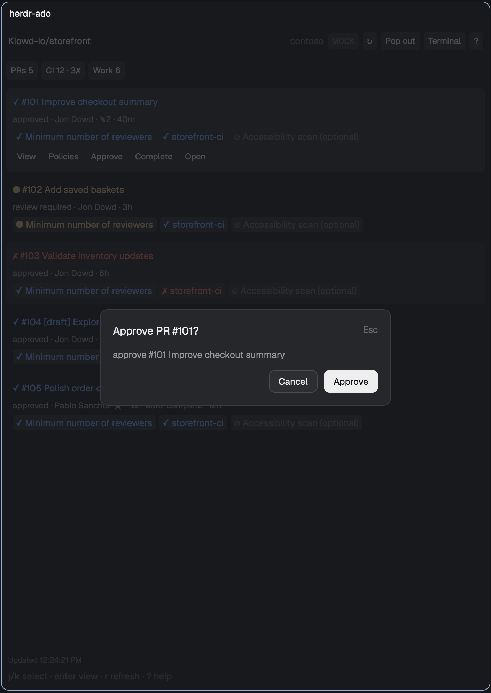</a><br>Approve dialog</td>
    <td align="center" valign="top"><a href="docs/screenshots/05-complete-dialog.png">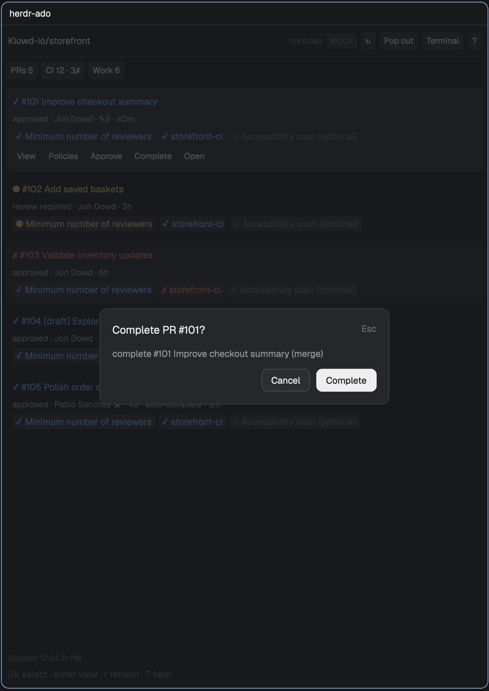</a><br>Complete dialog</td>
    <td align="center" valign="top"><a href="docs/screenshots/06-ci.png">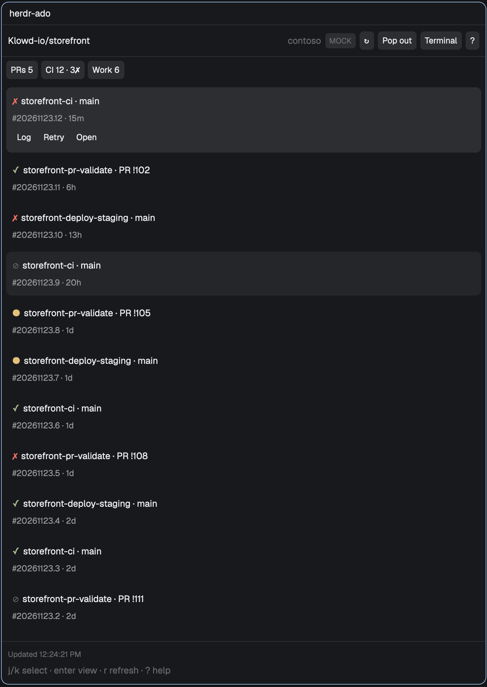</a><br>CI runs</td>
  </tr>
  <tr>
    <td align="center" valign="top"><a href="docs/screenshots/07-run-log.png">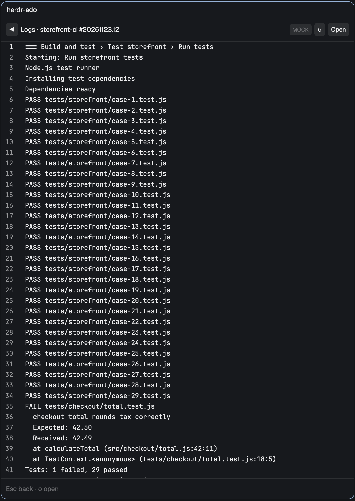</a><br>Failed run log</td>
    <td align="center" valign="top"><a href="docs/screenshots/08-retry-dialog.png">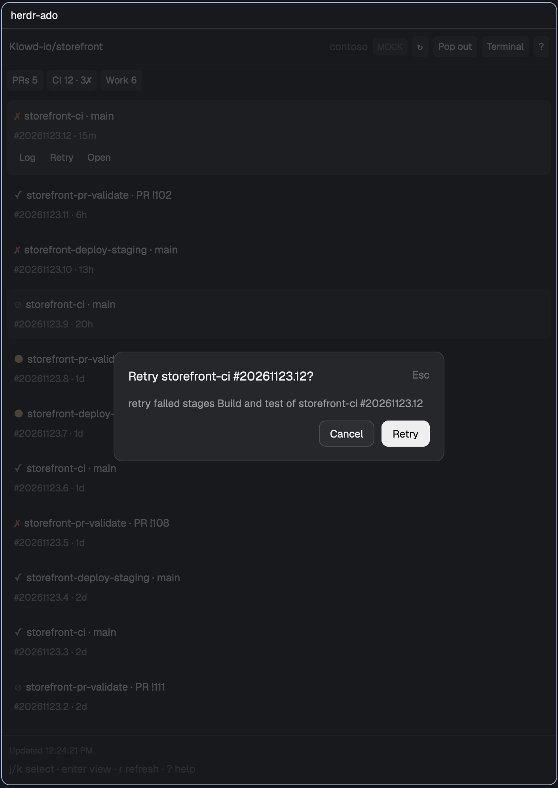</a><br>Retry dialog</td>
    <td align="center" valign="top"><a href="docs/screenshots/09-work.png">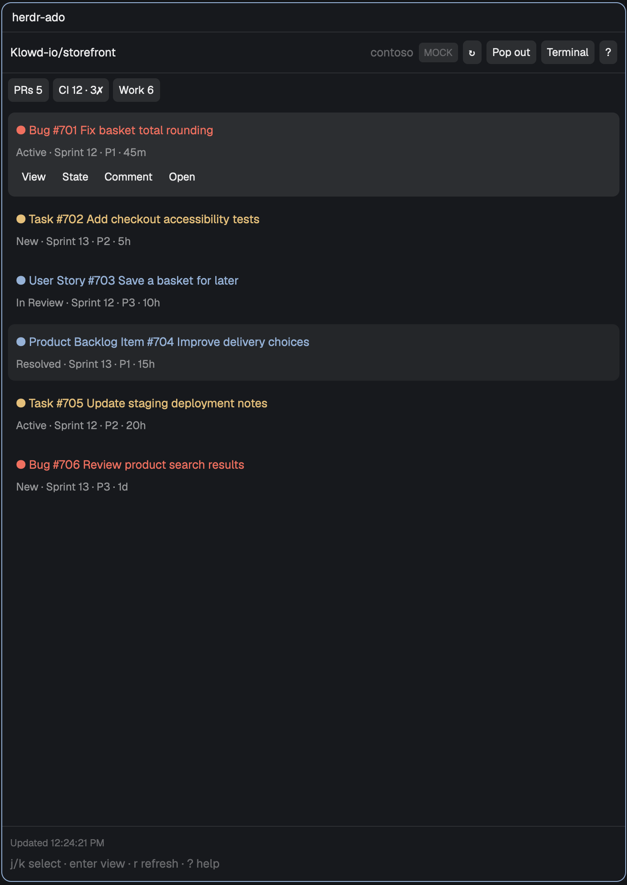</a><br>Work items</td>
  </tr>
  <tr>
    <td align="center" valign="top"><a href="docs/screenshots/10-work-item-detail.png">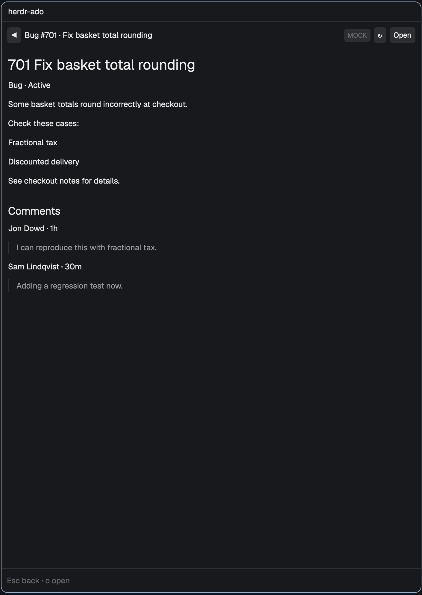</a><br>Work item detail</td>
    <td align="center" valign="top"><a href="docs/screenshots/11-state-picker.png">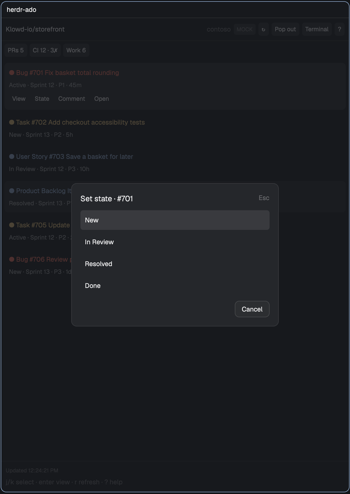</a><br>State picker</td>
    <td align="center" valign="top"><a href="docs/screenshots/12-comment-dialog.png">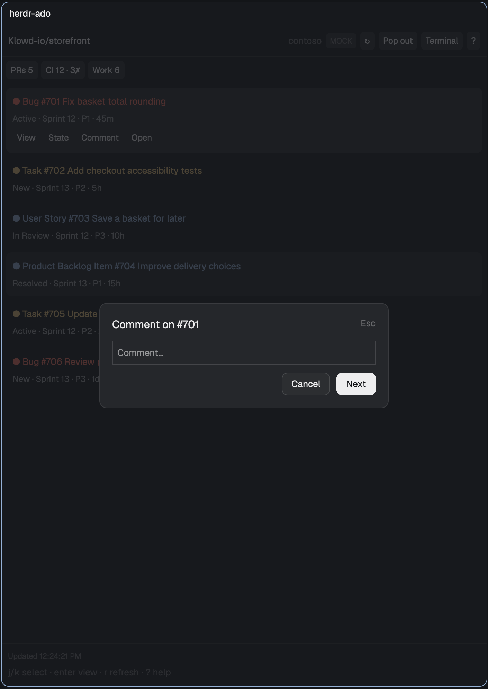</a><br>Comment dialog</td>
  </tr>
  <tr>
    <td align="center" valign="top"><a href="docs/screenshots/13-help.png">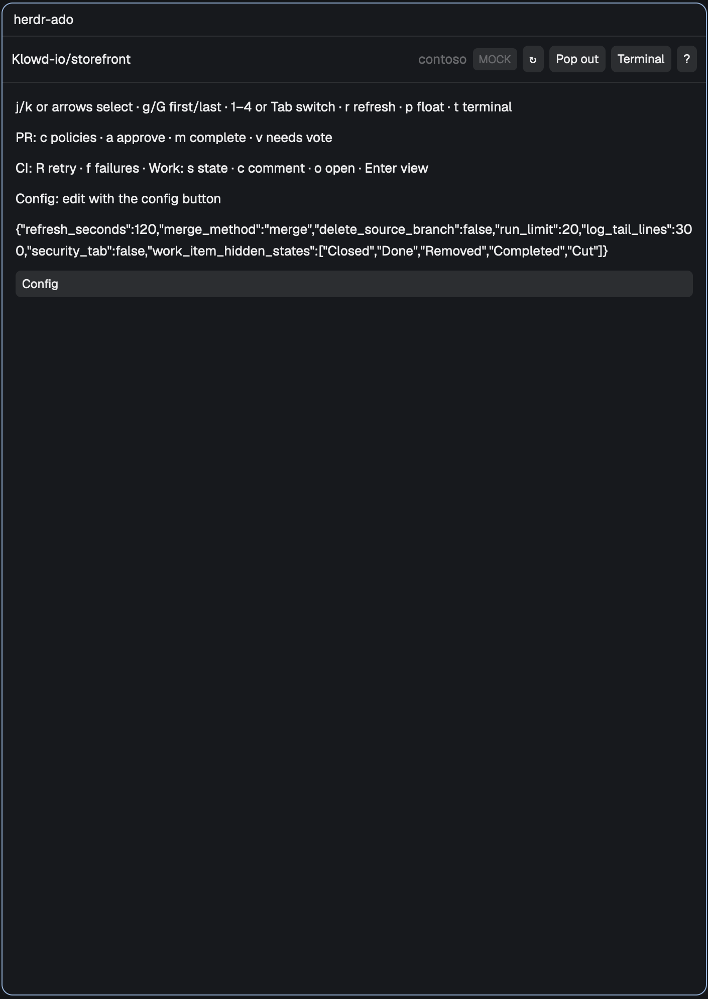</a><br>Help</td>
  </tr>
</table>

## Requirements

- Herdr desktop with herdr-core, Git, and Node.js 22 or newer for the terminal view.
- Azure CLI with the `azure-devops` extension, authenticated with `az login` or `az devops login`.
- `less` or `more` for terminal detail views, and `open` on macOS or `xdg-open` on Linux.

## Install

Copy the mod into Herdr's mods folder and check it. Keep the folder name `herdr-ado`: the mod refers to its own
files by that path.

```sh
cp -R mods/herdr-ado ~/.config/herdr-app/mods/
herdr-app check ~/.config/herdr-app/mods/herdr-ado
```

Then merge the two shortcuts from this repo's `keys.json` into the `global` section of
`~/.config/herdr-app/keys.json`. Ctrl-Alt-A opens the panel in a pane to the right in the current tab, or focuses
the copy already there. Ctrl-Alt-Shift-A toggles the floating window.

## Desktop panel

The panel follows the focused terminal's current directory, resolving its Git remote on that space's machine and
otherwise looking up its name in the default Azure DevOps organization. The header refreshes, opens a window or
moves it to a pane, opens the terminal view, and shows help and configuration. Enter or double-click opens details
inside the panel (on the Vulns tab it opens the alert in the browser). Escape or Backspace returns to the list.
Selected cards show their action buttons. Write actions ask for confirmation in a dialog over the panel, which also
holds the state picker and comment input.

## Terminal / phone

The Terminal button or `t` opens a named herdr-core terminal for a local space, so it is also available on Herdr
mobile. It reuses a live terminal for the repository. You can also run it directly:

```sh
node mods/herdr-ado/terminal/panel.js org/project/repo
```

An Azure DevOps URL is also accepted; with no argument the panel resolves the current directory's Git remote or name.
The terminal view uses a pager for details and supports narrow screens.

## Keys

| Key | Action |
| --- | --- |
| j/k, arrows, g/G | Select, first/last |
| 1–4, Tab | Switch tabs |
| r, o, ?, Enter | Refresh, browser, help, detail |
| p, t | Toggle window, open terminal (desktop) |
| c, a, m, v | PR policies, approve, complete/auto-complete, filter for my vote |
| R, f | Retry CI, filter failures |
| s, c | Work item state, comment |

Desktop confirmations accept y or Enter, and n or Escape cancels. State selection uses j/k, arrows, Enter, or a
click; Escape cancels. Terminal confirmations use y/N, and q or Escape exits the terminal panel.

## Configuration

Both views read `mods/herdr-ado/config.json`; defaults are created on first use. The desktop help's Config button
edits the JSON. Reload the mod after changing `refresh_seconds`.

```json
{
  "refresh_seconds": 120,
  "merge_method": "merge",
  "delete_source_branch": false,
  "run_limit": 20,
  "log_tail_lines": 300,
  "security_tab": false,
  "work_item_hidden_states": ["Closed", "Done", "Removed", "Completed", "Cut"]
}
```

Refresh has a 30-second minimum; merge method is `merge` or `squash`. The Azure CLI can't complete a PR with
`rebase` or `rebaseMerge`, so those values (or a branch policy that only allows them) make Complete point you to the
browser instead. Run limit is 1–100 and log tail is 50–5000 lines. `work_item_hidden_states` must be a non-empty
list of state names; work items in those states are left out. Enable `security_tab` for alerts.

## Known limitations

- Azure DevOps Services only (`dev.azure.com` and `*.visualstudio.com` organizations); Azure DevOps Server
  (on-premises) is not supported.
- Azure CLI runs locally even for remote spaces; Git runs on the space's machine. The terminal view requires a
  local space.
- Votes, auto-complete and completion are not commit-pinned. Approval and completion re-check the head just before
  sending, and refuse if someone pushed since you looked, but the Azure CLI does not lock the head in.
- Stage retry and Advanced Security depend on the organization's Azure DevOps capabilities.
- Desktop pane, focus, and floating behavior depend on the installed Herdr version.

## Develop

Run `npm test` without credentials or network access. `node mods/herdr-ado/terminal/panel.js --help` prints usage.
The desktop mod must also be checked and exercised in a running Herdr installation after copying it there.

Adapted from [herdr-gh](https://github.com/bpkennedy/herdr-gh). MIT; see LICENSE.
