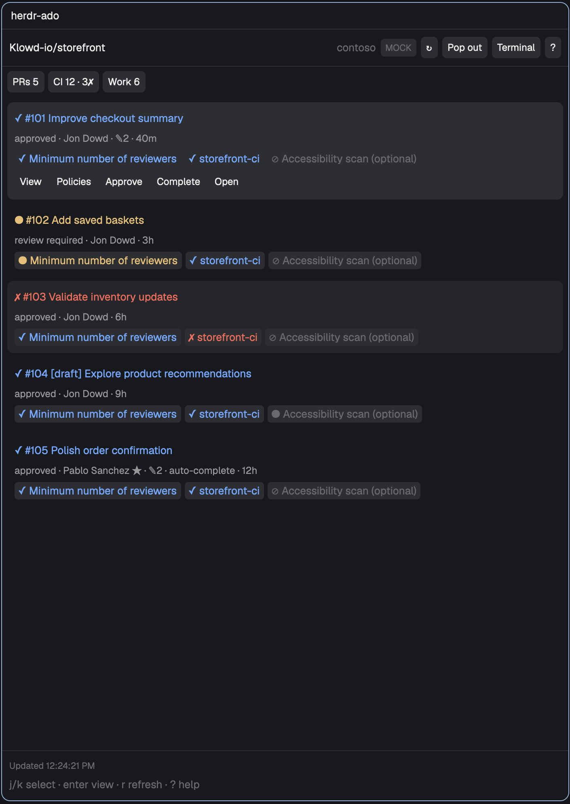

# Azure DevOps Ops

A desktop pane follows the current Herdr space and shows Azure DevOps PRs, pipeline runs, work items,
and optional security alerts, with a terminal view available to phones.

## What you see

A theme-colored pane has a repository header, refresh, window, terminal and help buttons, tab pills, a
scrollable card list and a footer. Selected cards expose action buttons. A floating copy is 440px wide; the panel
shows markdown details or read-only logs and policies in place of the list. Colors follow the Herdr theme.

## How it behaves

Cards show check status, reviews, authors, branches, dates and work item state. Theme working, blocked, done and
muted colors communicate status. Click selects, double-click opens details, and hover highlights controls. j/k and
arrows select; g/G jump; 1–4 and Tab switch; Enter opens details. r refreshes, p toggles a window, t opens the
terminal, o opens the browser, and ? shows help. PR c/a/m/v, CI R/f and Work s/c open policies, perform actions
or filter. Writes open a confirmation dialog over the panel (state picker and comment input included); y or Enter
confirms, and Escape cancels input, state selection or confirmation.

## Built from

`mods/herdr-ado/mod.json` uses `place: none`; Ctrl-Alt-A opens or focuses a pane in the current tab.
Ctrl-Alt-Shift-A toggles a floating window through an invisible popup launcher. Props select a pane or window. Shared core
modules provide Azure DevOps operations to the native view and `terminal/panel.js`. The mod calls Herdr's live space,
focus, theme and settings APIs, `exec`, `hc`, `run`, overlays, notifications and file APIs. It runs Git, Azure CLI,
Node and the browser opener; Azure CLI contacts Azure DevOps. The spinner is Herdr's workspace-chrome SVG. The root
`keys.json` supplies pane and window shortcuts.

## Watch out

Azure CLI is local even for remote spaces; only Git runs remotely. Terminal view needs a local space. The config file
is shared with the terminal view. Use hidden temporary files for Azure request bodies and remove them after use;
never run commands or create files while `checking()`. Focus and floating copies have independent view state.

## Done when

The panel follows space changes, shows cards and confirmation dialogs, opens details and a floating copy, and the
terminal view opens or reuses a named herdr-core terminal. Config applies to both views. `npm test` passes, and the
installed mod passes `herdr-app check` and is exercised in the live app.
